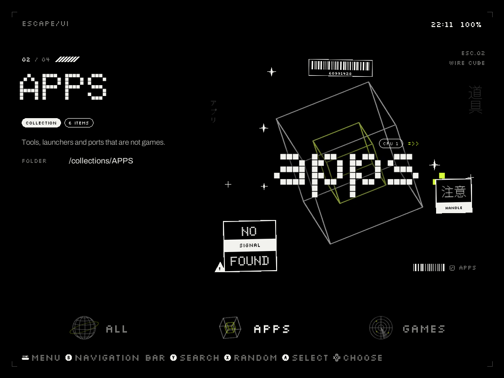
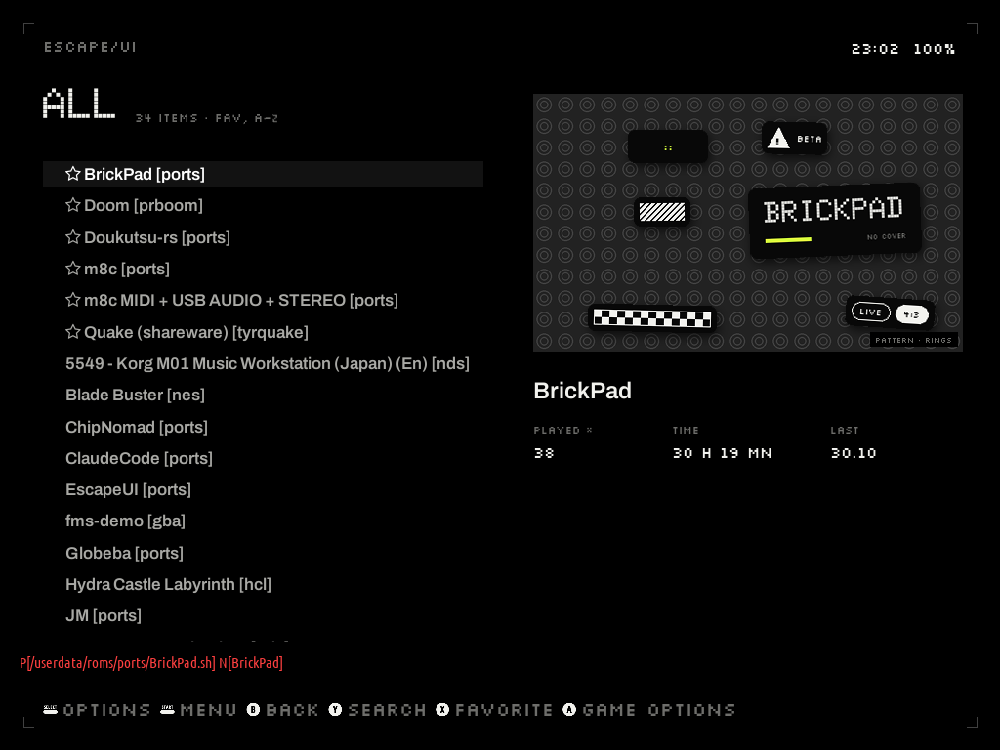
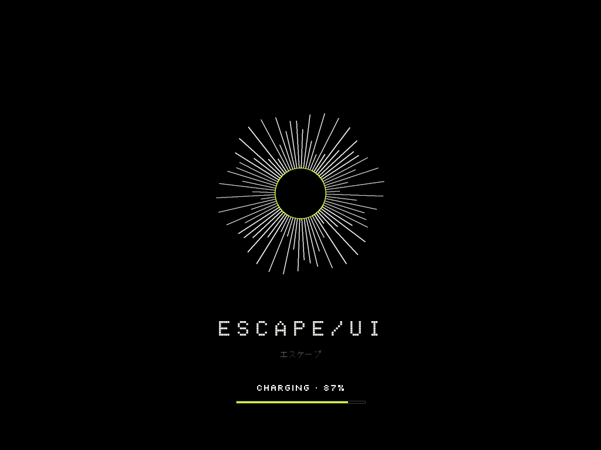
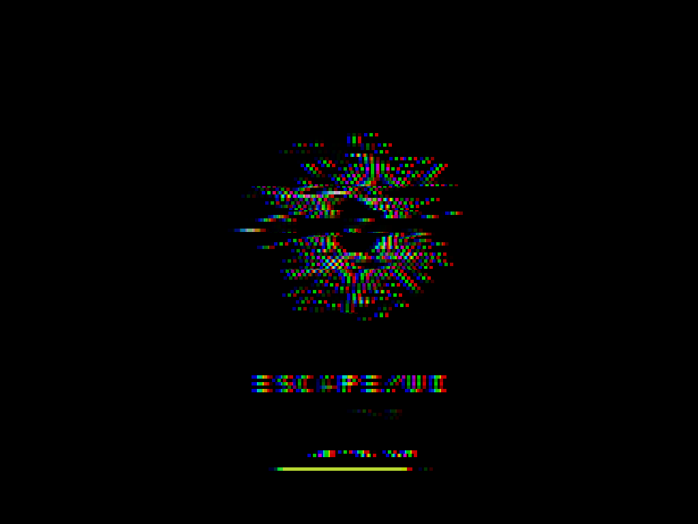
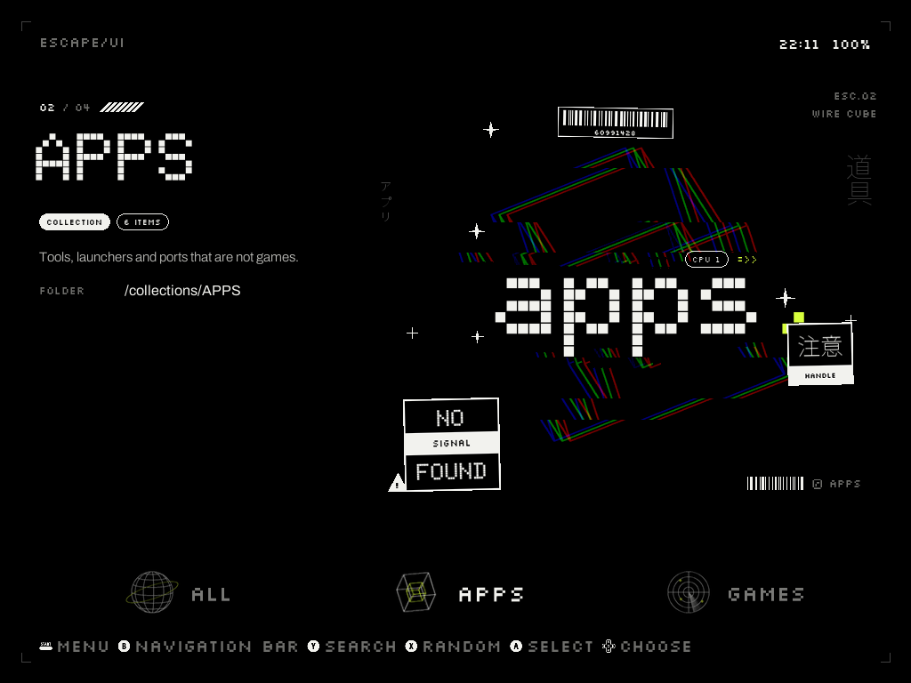

<p align="center"></p>

<h1 align="center">escape/UI</h1>

<p align="center">
An EmulationStation theme for the <b>TrimUI Brick</b> on <b>Knulli</b>.<br>
Black screen, hairlines, dot-matrix type and stickers: Nothing × Apple × Y2K × brutalism.<br>
<a href="https://obhateion.github.io/escape-ui/demo.html"><b>▶ Try it in your browser</b></a> ·
<a href="https://obhateion.github.io/escape-ui/">Project page</a> ·
<a href="../../releases/latest">Download</a> ·
<a href="docs/escape-ui-guide-en.pdf">Guide (PDF)</a> ·
<a href="README.ru.md">По-русски</a>
</p>

<p align="center"> </p>

## What it is

Every collection (or console) on the home screen gets one of **18 turning wire figures**, a big
dot-matrix label and a cloud of stickers. Every game gets its own **sticker sheet** on a grey
pattern, with its picture as a Polaroid. All of it is drawn for *your* collections and games —
and drawn ahead, so the console only shows pictures.

* **10 accent colours**, switched instantly from ES's menu.
* **Detail level 0–5** for the home screen, **cover stickers 0–5** for the game sheets.
* **Figure motion**: video loops (with a glitch entrance), *light* (a still figure that turns and breathes) or still.
* **Charging screen**: on the charger and untouched for 15 s, the boot screen shows a turning figure,
  glitch bursts and the charge. Any button brings the menu back — the figure glitches back in.
* **Low battery pulse**, optional **chromatic aberration**, **smooth mode** (full CPU speed on the menus).
* **Settings app "escape-UI"** (in PORTS): figure per collection, pattern per game, boot logo, cover picture per game, colours.
* Works without custom collections: consoles and ES's own collections (favourites, last played…) get cards too;
  names in any script (Cyrillic, Japanese, Korean…), names with `: ? * "` and unscraped games are handled.

<p align="center">  </p>

## Install

1. Download `escape-ui-theme-vX.Y.zip` from [Releases](../../releases/latest).
2. Copy the `themes` and `roms` folders from the archive to the root of **SHARE** (`/userdata`),
   over the network (`\\KNULLI\share`) or with the SD card in a computer. The theme must end up at
   `/userdata/themes/es-theme-escape-ui`.
3. On the Brick: *UPDATE GAMELISTS* (or reboot), then start **EscapeUI** from PORTS.
4. Setup screen: **A** — turn the theme on; **X** — the same, plus custom collections straight on the home screen; **B** — leave.

The first run draws the art for the current colour (a few minutes, with a progress bar), then ES restarts with the theme.
The other colours are drawn while the Brick charges and nobody touches it — or, much faster, on a PC (below).

Full guide: [English PDF](docs/escape-ui-guide-en.pdf) · [Русский PDF](docs/escape-ui-guide-ru.pdf)

## Draw everything on a PC (optional, recommended)

The Brick can draw everything itself, but a PC does it ~3× faster and keeps the console cool.
Needs Python 3.12 + Pillow + numpy and ffmpeg.

```sh
# on the Brick (ssh): what to draw
python3 /userdata/themes/es-theme-escape-ui/tool/gen.py --snapshot > snapshot.json
# on the PC, in themes/es-theme-escape-ui/tool
ESCAPE_PC=snapshot.json ESCAPE_GEN=out ESCAPE_FFMPEG=ffmpeg ESCAPE_JPFONT=NotoSansJP-VF.ttf \
  python gen.py --all-colours --all-levels      # every colour, every cover level
ESCAPE_PC=snapshot.json ESCAPE_GEN=out python gen.py --library   # every figure / pattern / boot logo variant
```

Copy the folders from `out/` into `/userdata/themes/es-theme-escape-ui/gen/` and restart ES.
With the library in place, picking another figure, pattern or boot logo in the app is a file copy.
(`NotoSansJP-VF.ttf` is on the Brick in `/usr/share/fonts/truetype/noto/`.)

## How it works

* `tool/gen.py` — the generator: cards, stickers, sheets, videos, charging loops, the variant library.
  It reads your collections (`custom-*.cfg`, `*.xcc`), gamelists, rom folders and ES settings.
* `theme.xml` — ES theme; pictures are bound per collection (`${system.theme}`) and per game
  (`{game:name}`, or `{game:path}` when a name can't be a file name on exFAT).
* `tool/app.py` — the settings app (pygame). `tool/charged.py` — watches the charger, shows
  `tool/charge_screen.py`, keeps the smooth mode. `events/escape-ui.sh` — ES event hook.
* `mockup/` — the browser demo: the same drawing code ported to JavaScript (with CPython's random
  number generator, so the stickers land in the same places). `python mockup/build.py --demo docs/demo.html`.

## Uninstall

UI SETTINGS → THEME SET → another theme. Then delete `/userdata/themes/es-theme-escape-ui`,
`/userdata/roms/ports/EscapeUI.sh`, `/userdata/system/configs/escape-ui`, the `escape-ui.sh`
files in `/userdata/system/configs/emulationstation/scripts/*/`, and the two lines after
`# escape/UI` in `/userdata/system/custom.sh`.

## Licence

Code: MIT (see `LICENSE`). Fonts: Doto, Silkscreen, Archivo, Martian Mono — SIL Open Font License
(texts in `themes/es-theme-escape-ui/fonts/`). Japanese and other scripts use Knulli's system fonts.
Not affiliated with TrimUI, Knulli, Batocera or EmulationStation.
