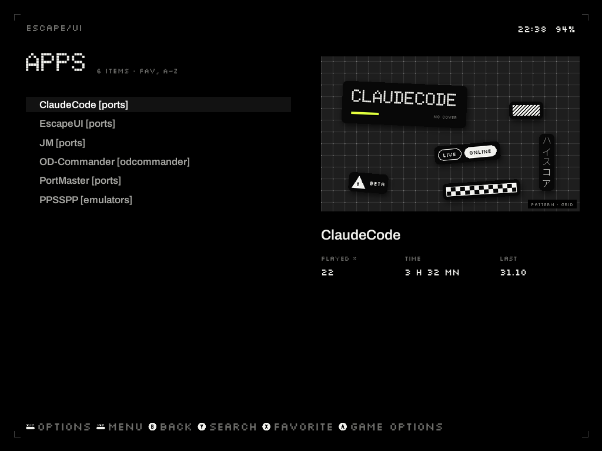
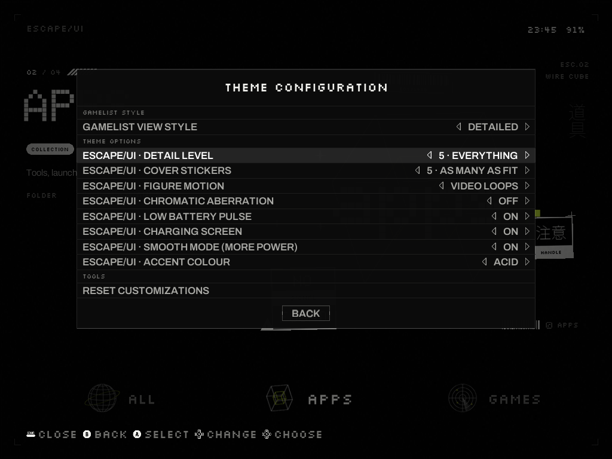
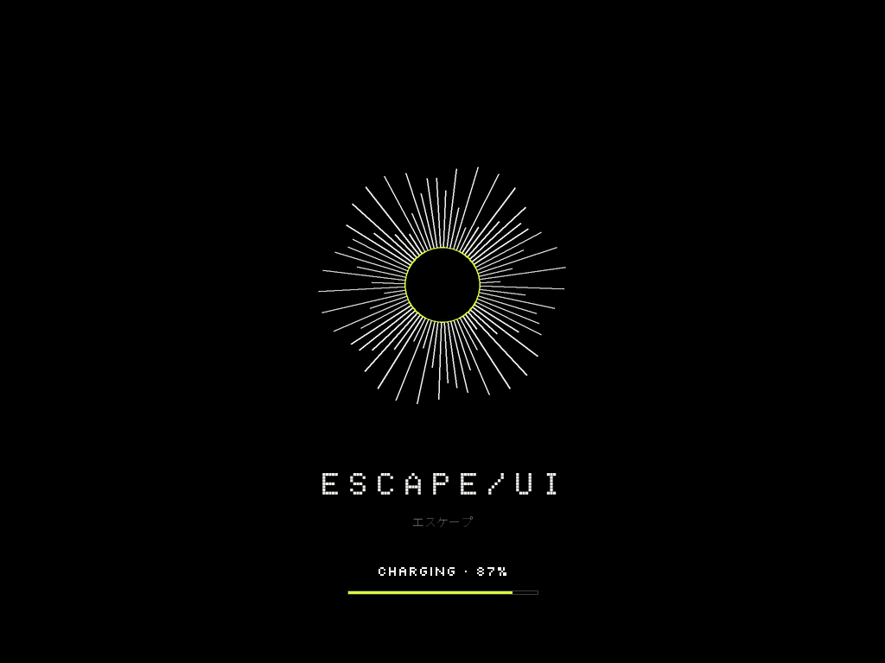
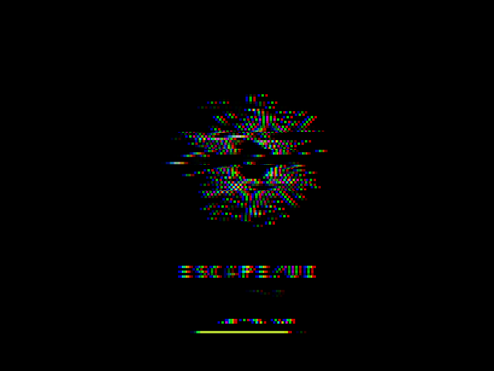
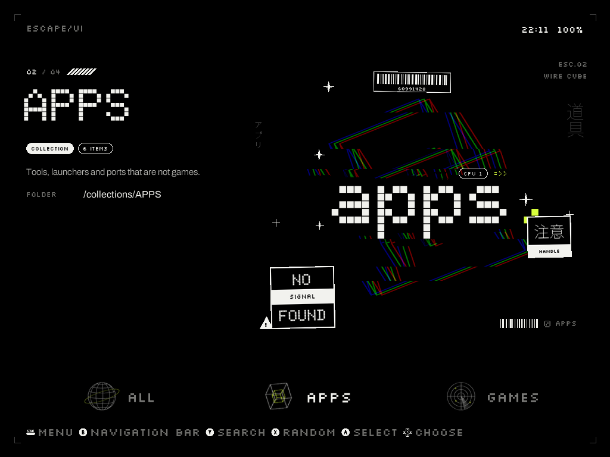

<h1 align="center">escape/UI</h1>

Тема для EmulationStation на <b>TrimUI Brick</b> с <b>Knulli</b>. 
Чёрный экран, тонкие линии, точечные шрифты, наклейки: Nothing × Apple × Y2K × брутализм. 
<a href="https://obhateion.github.io/escape-ui/demo.html"><b>▶ Попробовать в браузере</b></a> ·
<a href="https://obhateion.github.io/escape-ui/">Страница проекта</a> ·
<a href="../../releases/latest">Скачать</a> ·
<a href="docs/escape-ui-guide-ru.pdf">Инструкция (PDF)</a> ·
<a href="README.md">English</a>

 

## Что это

У каждой коллекции (или консоли) на главном экране — своя **вращающаяся проволочная фигура** из 18,
крупная точечная надпись и россыпь наклеек. У каждой игры — свой **лист наклеек** на сером узоре,
с её картинкой в виде полароида. Всё рисуется под *ваши* коллекции и игры — и заранее, так что
приставка только показывает готовые картинки.

* **10 цветов акцента**, переключаются мгновенно из меню оболочки.
* **Детализация 0–5** для главного экрана и **наклейки на обложках 0–5**.
* **Движение фигур**: видео (с глитч-появлением), *light* (картинка медленно поворачивается и «дышит») или без движения.
* **Экран зарядки**: на зарядке и 15 секунд без кнопок — экран загрузки с вращающейся фигурой, глитчами
  и процентом заряда. Любая кнопка — назад в меню, фигура проявляется через глитч.
* **Пульс при низком заряде**, **хроматическая аберрация**, **плавный режим** (полная частота процессора в меню).
* **Приложение «escape-UI»** (в PORTS): фигура для коллекции, узор для игры, бут-лого, картинка обложки, цвета.
* Работает и без кастомных коллекций: свои карточки получают консоли и автоколлекции оболочки
  (избранное, последние…); названия на любом языке, названия с `: ? * "` и игры без скрапа — тоже.

  

## Установка

1. Скачайте `escape-ui-theme-vX.Y.zip` в [Releases](../../releases/latest).
2. Скопируйте папки `themes` и `roms` из архива в корень раздела **SHARE** (`/userdata`) — по сети
   (`\\KNULLI\share`) или картой в компьютере. Тема должна оказаться в `/userdata/themes/es-theme-escape-ui`.
3. На приставке: *UPDATE GAMELISTS* (или перезагрузка), затем запустите **EscapeUI** из PORTS.
4. Экран установки: **A** — включить тему; **X** — то же + кастомные коллекции сразу на главном экране; **B** — выйти.

Первый запуск рисует картинки текущего цвета (несколько минут, с полосой прогресса), затем оболочка
перезапускается с темой. Остальные цвета приставка дорисует сама на зарядке — или гораздо быстрее
на компьютере (см. [README.md](README.md#draw-everything-on-a-pc-optional-recommended)).

Подробно: [инструкция PDF](docs/escape-ui-guide-ru.pdf).

## Удаление

UI SETTINGS → THEME SET → другая тема. Затем удалить `/userdata/themes/es-theme-escape-ui`,
`/userdata/roms/ports/EscapeUI.sh`, `/userdata/system/configs/escape-ui`, файлы `escape-ui.sh`
в `/userdata/system/configs/emulationstation/scripts/*/` и две строки после `# escape/UI`
в `/userdata/system/custom.sh`.

## Лицензия

Код — MIT (`LICENSE`). Шрифты Doto, Silkscreen, Archivo, Martian Mono — SIL Open Font License.
Японский и другие алфавиты — системные шрифты Knulli. Проект не связан с TrimUI, Knulli, Batocera и EmulationStation.
